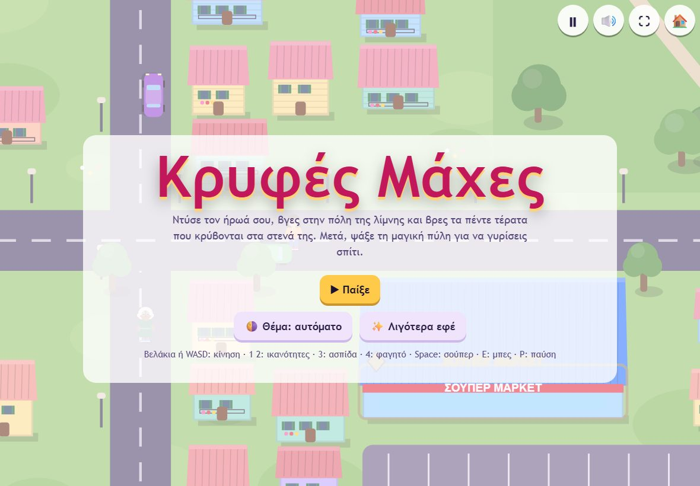
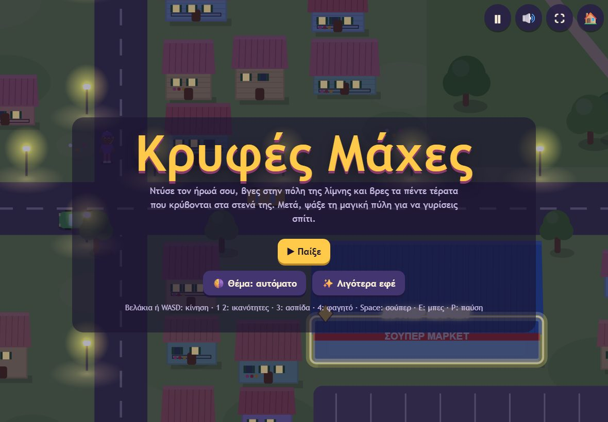
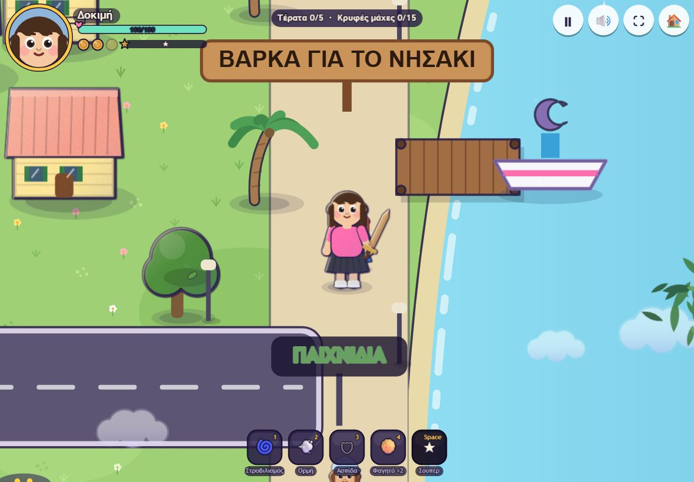
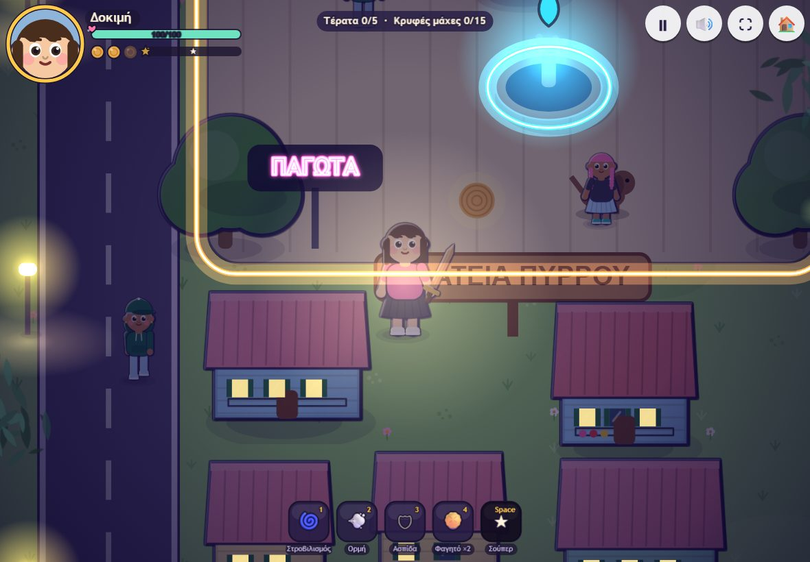
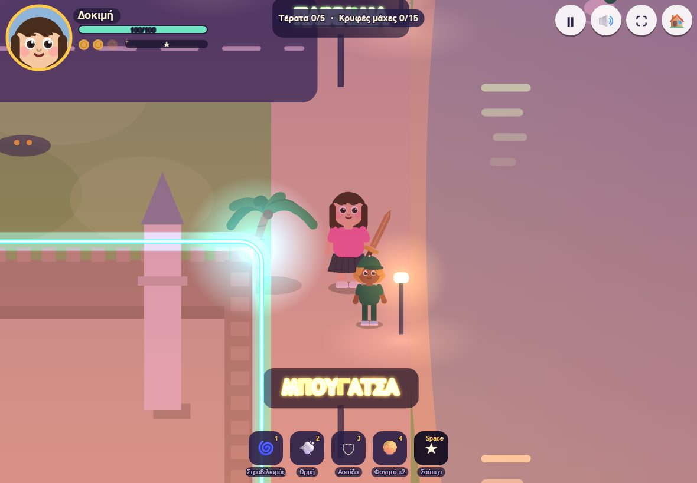

# Κρυφές Μάχες

Παιχνίδι του σπιτιού για παιδιά **7–9 ετών**, φτιαγμένο με το [GAME-STANDARD](GAME-STANDARD.md) (v1.2).
Παίζεται στο «Τα Παιχνίδια μας», το hub με όλα τα παιχνίδια του σπιτιού (διαδρομή `/kryfes-maches/`). Οι
διευθύνσεις παραγωγής και staging είναι στο README του games-hub (το repo αυτό είναι δημόσιο: χωρίς hostnames).

Το README είναι και ο **οδηγός χειροκίνητης δοκιμής** (GAME-STANDARD §2a): οθόνες, λίστα δοκιμών KM-xx, τι
άλλαξε, περιορισμοί, ασφαλής δοκιμή και αναφορά προβλήματος.

## Η ιστορία

Στην πόλη με τη λίμνη, κάτω από τον λόφο, κρύβονται **πέντε τέρατα** και πολλά Σκιουλάκια. Τίποτα δεν φαίνεται
από μακριά. Πλησίασε και θα δεις!

Ντύνεις τον ήρωά σου στο σπίτι, βγαίνεις στην πόλη και ψάχνεις. Κάθε νίκη ανοίγει νέα ρούχα και ένα πιο δυνατό
όπλο. Όταν νικήσεις και τα πέντε τέρατα, ανοίγει κάπου στην πόλη η μαγική πύλη που σε γυρίζει σπίτι, στην
οικογένειά σου.

Τα τέσσερα τέρατα που ξέρουν όλοι: **ο Βραχυντής, η Γατοουρανιοτοξογρίλια, η ΗλιοΛίμνη, το ΣακουλοΦως**. Το
πέμπτο είναι **μυστικό**: το βρίσκουν τα παιδιά μόνα τους (το README δεν λέει ούτε όνομα ούτε σημείο).

Εκτός από τα 5 τέρατα υπάρχουν και **15 κρυφές μάχες** με Σκιουλάκια. Στο σπίτι ξεκλειδώνονται **20 όπλα**, από
το «Ξύλινο σπαθάκι» μέχρι τη «Θρυλική Λεπίδα της Λίμνης», σε τρία είδη: «Από κοντά», «Από μακριά», «Μαγεία».

Δεν υπάρχει τίποτα τρομακτικό: τα τέρατα γίνονται σπίθες. Αν κουραστείς, γυρνάς σπίτι χωρίς να χάσεις τίποτα από
όσα ξεκλείδωσες.

## Χειρισμός

| | Πληκτρολόγιο | Αφή (tablet) |
|---|---|---|
| Κίνηση | Βελάκια ή WASD | joystick αριστερά |
| Ικανότητες του όπλου | 1 και 2 | ⚡ 💨 δεξιά |
| Ασπίδα | 3 | 🛡 |
| Φαγητό | 4 | 🥧 |
| Σούπερ επίθεση | Space | ★ |
| Μπες (σπίτι, βάρκα, πύλη) | E | 👆 |
| Παύση / Ήχος / Πλήρης οθόνη | P ή Esc / M / F | ⏸ 🔊 ⛶ |

Το όπλο χτυπά μόνο του όταν είσαι κοντά σε τέρας. 🏠 γυρίζει στα παιχνίδια. Το παιχνίδι παίζεται οριζόντια.
Στην πόλη μπαίνει μόνο του σε παύση όταν κρύβεται η καρτέλα ή χάνεται η εστίαση.

Στον τίτλο και στην παύση: **«🌗 Θέμα: αυτόματο»** (πάτημα → «☀️ Θέμα: φωτεινό» → «🌙 Θέμα: σκοτεινό» → ξανά
αυτόματο) για τα μενού, και **«✨ Λιγότερα εφέ»** (✓ όταν είναι αναμμένο) για πιο ελαφριά γραφικά.

## Οθόνες και ροή

Τίτλος → «Ποιος παίζει;» (θέσεις, PIN, προφίλ) → νέος ήρωας → «Η ιστορία» → σπίτι με τον καθρέφτη → πόλη →
μάχη → νίκη ή «Ωχ! Κουράστηκες...» → σπίτι. Τα κείμενα όπως φαίνονται στην οθόνη:

1. **Τίτλος:** «Κρυφές Μάχες», μια πρόταση για το παιχνίδι, κουμπί «▶ Παίξε», τα κουμπιά «🌗 Θέμα: αυτόματο» και
   «✨ Λιγότερα εφέ», και η γραμμή με τα πλήκτρα
   («Βελάκια ή WASD: κίνηση · 1 2: ικανότητες · 3: ασπίδα · 4: φαγητό · Space: σούπερ · E: μπες · P: παύση»).
   Πίσω από τον τίτλο η πόλη ζει, με την ώρα της μέρας.
2. **«Ποιος παίζει;»:** 3 θέσεις. Κενή θέση: «Κενή θέση 1», «Φτιάξε νέο ήρωα», «Νέο παιχνίδι». Γεμάτη θέση:
   πορτρέτο, όνομα, «Τέρατα x/5 · Μάχες y/20» (🏆 όταν τελείωσε), «Χρόνος παιχνιδιού …», «Συνέχεια» και «Σβήσε»
   (δεύτερο πάτημα: «Σίγουρα; Σβήσε»). «← Πίσω» γυρίζει στον τίτλο. Από πάνω, όταν απαντά το hub, το κουτί της
   αποθήκευσης στο σπίτι (ενότητα «Αποθήκευση»).
3. **Νέος ήρωας:** «Ποιον ήρωα θα ετοιμάσεις;» με δύο φιγούρες, «Πώς λένε τον ήρωα;» (ως 14 γράμματα, π.χ.
   «Ηλέκτρα»), «← Πίσω» και «Ξεκίνα την περιπέτεια →» (χωρίς όνομα δεν ξεκινά, η εστίαση μένει στο πεδίο).
4. **«Η ιστορία»:** τρεις παράγραφοι και «Πάμε να ετοιμαστώ! →».
5. **Σπίτι, ο καθρέφτης (ντύσιμο):** αριστερά ο καθρέφτης με τον ήρωα και τη γραμμή με όπλο, πανοπλία,
   ικανότητες και «Φαγητό n/3». Δεξιά:
   - επικεφαλίδα «Το σπίτι μου · <όνομα>» και «Νίκες n/20 · Τέρατα n/5»·
   - **καρτέλες κατηγορίας** «Πρόσωπο», «Μαλλιά», «Ρούχα», «Μαγικά», «Μάχη»·
   - **chips υποκατηγορίας** (π.χ. «Δέρμα», «Μάτια», «Χτένισμα», «Χρώμα μαλλιών», «Μπλούζα», «Κάπα», «Φτερά»,
     «Όπλο», «Πανοπλία»)· ● δίπλα σε chip σημαίνει κάτι νέο μέσα·
   - καρτέλες και chips είναι μια γραμμή που κυλά οριζόντια· όσο κρύβεται κάτι, η άκρη σβήνει και φαίνονται τα
     κουμπιά **‹ ›**· το επιλεγμένο μένει πάντα ορατό·
   - **κάρτες επιλογών** (≥ 72 px) με προεπισκόπηση και σύντομο όνομα· η επιλεγμένη έχει χρυσό περίγραμμα·
     **«ΝΕΟ»** = ξεκλειδώθηκε από την τελευταία έξοδο στην πόλη· **κλειδωμένη κάρτα** = γκρι προεπισκόπηση και 🔒,
     και με πάτημα γράφει «🔒 Ανοίγει μετά από N ακόμα νίκες (τέρατα ή κρυφές μάχες).»·
   - γραμμή βοήθειας (π.χ. «Ετοίμασε τον ήρωά σου μπροστά στον καθρέφτη. Όταν είσαι έτοιμος, βγες στην πόλη!»)·
   - κουμπιά **«🎲 Τυχαίο»** (τυχαίο ντύσιμο μόνο από όσα είναι ανοιχτά· δέρμα, όπλο και πανοπλία μένουν),
     **«💾 Αποθήκευση»** («Αποθηκεύτηκε ✓») και **«🚪 Βγες στην πόλη»**.
   - Σε χαμηλή οθόνη (≤ 500 px ύψος, π.χ. κινητό 780×360): μικρότερος καθρέφτης, βοήθεια σε μία γραμμή (με πάτημα
     φαίνεται όλη), οι επιλογές σε μία σειρά πάνω από τα τρία κουμπιά. Σε στενό κάθετο παράθυρο: μικρότερος
     καθρέφτης πάνω, συμπαγή κουμπιά.
6. **Πόλη:** «Ψάξε στην πόλη! Μένουν 5 τέρατα.». Πάνω η μπάρα «Τέρατα n/5 · Κρυφές μάχες n/15». Κοντά σε πόρτα ή
   βάρκα εμφανίζεται «Μπες στο σπίτι», «Βάρκα για το Νησάκι», «Βάρκα για την πόλη» (E ή 👆).
   Μια παστέλ παραλίμνια πόλη με φοίνικες, φανοστάτες, σιντριβάνι στην πλατεία και ελληνικές πινακίδες νέον
   (ΠΙΤΕΣ, ΠΑΓΩΤΑ, ΣΙΝΕΜΑ, ΠΑΙΧΝΙΔΙΑ, ΜΠΟΥΓΑΤΣΑ, ΚΟΥΛΟΥΡΙΑ, ΣΟΥΠΕΡ ΜΑΡΚΕΤ). **Η μέρα αλλάζει μόνη της:** μία μέρα του
   παιχνιδιού κρατά περίπου 5 λεπτά παιχνιδιού (η παύση δεν μετρά): αυγή, μέρα, ηλιοβασίλεμα (ροζ/πορτοκαλί),
   νύχτα (βαθύ μωβ). Κάθε επίσκεψη ξεκινά πρωί. Τη νύχτα ανάβουν τα παράθυρα, οι φανοστάτες, οι πινακίδες (γράμμα
   γράμμα) και **έξι μέρη**, το καθένα με δικό του χρώμα και σχήμα: **Κάστρο** (σημαία), **Νησάκι** (αστέρι),
   **Πλατεία με σιντριβάνι** (σταγόνα), **Σούπερ μάρκετ** (ρόμβος), **Το σπίτι μας** (καρδιά), **Η βάρκα**
   (φεγγάρι). Η λίμνη παίρνει τα χρώματα του ουρανού και καθρεφτίζει τα φώτα. Ο ήρωας κρατά λίγο φως γύρω του.
7. **Μάχη:** κρυφή μάχη «Κρυφή μάχη! Σκιουλάκια!» ή ένα τέρας. Νίκη: «Νίκησες τα Σκιουλάκια!» ή «Νίκησες …!»,
   μετά «Νέο όπλο: …! Φόρεσέ το στο σπίτι.» και «n νέα πράγματα στη ντουλάπα του σπιτιού!». Στα δυνατά χτυπήματα
   (ικανότητες 1 2, σούπερ) σπίθες και μεγάλες λέξεις «ΜΠΑΜ!», «ΖΑΠ!», «ΚΡΑΚ!»· όταν ένας εχθρός γίνεται σπίθες,
   «ΠΟΥΦ!». Ποτέ αίμα. Μικρό τράνταγμα οθόνης στα μεγάλα χτυπήματα (όχι με «Λιγότερα εφέ» ή με μειωμένη κίνηση
   της συσκευής). Τη νύχτα ο κύκλος της μάχης φωτίζεται.
8. **Ήττα:** «Ωχ! Κουράστηκες...», «Δεν χάθηκε τίποτα», συμβουλή, «🏡 Πάμε σπίτι».
9. **Παύση (P, Esc, ⏸):** «⏸ Παύση», «▶ Συνέχεια», «💾 Αποθήκευση», «🏡 Πήγαινε σπίτι» (στην πόλη), «Αρχική οθόνη»,
   «🌗 Θέμα: …» και «✨ Λιγότερα εφέ». Αν η συσκευή αργεί πολύ (για 3 δευτ.), τα «Λιγότερα εφέ» ανάβουν μόνα τους
   μία φορά, με μήνυμα «Λιγότερα εφέ: άναψαν μόνα τους, για να τρέχει πιο γρήγορα».
10. **Τέλος:** μετά τα 5 τέρατα «Η μαγική πύλη άνοιξε κάπου στην πόλη! Ψάξε τη!», μετά «Μπες στη μαγική πύλη» και
    η οθόνη «🏆 Μπράβο, <όνομα>!» με «Συνέχισε να εξερευνάς» και «Αρχική οθόνη».
11. **Κάθετη συσκευή αφής:** «Γύρισε τη συσκευή οριζόντια για να παίξεις!». Στο παιχνίδι (σπίτι, πόλη) το μήνυμα
    καλύπτει όλη την οθόνη· στα μενού (τίτλος, «Ποιος παίζει;», νέος ήρωας, παύση) είναι μόνο μια λωρίδα κάτω, και τα
    μενού διαβάζονται και πατιούνται κανονικά (GAME-STANDARD §3a).

**Θέμα:** τα μενού και οι οθόνες (τίτλος, θέσεις, καθρέφτης, παύση, νίκη/ήττα) ακολουθούν το θέμα της συσκευής
(φωτεινό παστέλ ή σκοτεινό «σούρουπο»), εκτός αν διαλέξεις «φωτεινό» ή «σκοτεινό». Η πόλη κρατά τα δικά της χρώματα
της ώρας και στα δύο.

| Μέρα, φωτεινό θέμα | Νύχτα, σκοτεινό θέμα |
|---|---|
|  |  |
|  |  |

**Ξεκλειδώματα:** κάθε νίκη (τέρας ή κρυφή μάχη) μετρά 1, ως 20. Το όπλο νούμερο n ανοίγει στις n νίκες· τα
ρούχα, οι μάσκες, τα φτερά, οι πανοπλίες κ.λπ. έχουν το δικό τους όριο νικών. Ό,τι ανοίγει δεν ξανακλειδώνει.

## Αποθήκευση

Από το WP-K2 (2026-10-15) το παιχνίδι έχει **δύο επίπεδα** (GAME-STANDARD §5):

- **Στο σπίτι (Επίπεδο Β, μέσω του hub):** στο «Ποιος παίζει;» το κουτί «Αποθήκευση στο σπίτι: γράψε τον
  οικογενειακό κωδικό» ζητά τον **οικογενειακό 4ψήφιο κωδικό (PIN)** και «Άνοιγμα». Μηνύματα: «Λάθος κωδικός»,
  «Περίμενε λίγο και ξαναδοκίμασε» (πολλά λάθη), «Το σπίτι δεν απαντά: η αποθήκευση γίνεται μόνο εδώ».
  Μετά το «Προφίλ στο σπίτι:» δείχνει τα **προφίλ** της οικογένειας (👉 = το επιλεγμένο), το
  **«Μόνο σε αυτή τη συσκευή»** και το πεδίο «Νέο προφίλ» με «Νέο» (όνομα ως 20 χαρακτήρες· αν δεν γίνει:
  «Δεν έγινε. Δοκίμασε άλλο όνομα.»). Κάθε προφίλ έχει τις δικές του **3 θέσεις**, που ανοίγουν από κάθε
  συσκευή με το ίδιο προφίλ. Η διαγραφή μιας αποθήκευσης ή ενός προφίλ στο σπίτι γίνεται στη σελίδα «Προφίλ» του hub.
- **Στη συσκευή (Επίπεδο Α, πάντα):** κλειδί `game.kryfes-maches.v1` (σχήμα 1, αμετάβλητο). Με «Μόνο σε αυτή τη
  συσκευή» οι 3 θέσεις μένουν μόνο στο πρόγραμμα περιήγησης. Το ίδιο κλειδί κρατά και αντίγραφο των θέσεων κάθε
  προφίλ, ώστε το παιχνίδι να δουλεύει και χωρίς δίκτυο.
- **Σιωπηλή εναλλακτική:** αν το hub δεν έχει κωδικό (503) ή δεν απαντά, **δεν εμφανίζεται κανένα μήνυμα ούτε κουτί
  κωδικού**· το παιχνίδι αποθηκεύει στη συσκευή και στέλνει τις θέσεις που άλλαξαν όταν ξαναβρεί το hub.
- **Το σπίτι ξέχασε το ξεκλείδωμα (401):** αν το hub απαντήσει 401 σε μια αποθήκευση ή φόρτωση (π.χ. μετά από
  επανεκκίνηση), το «Ποιος παίζει;» ζητά ξανά τον οικογενειακό κωδικό και δείχνει τις θέσεις της συσκευής. Η
  αποθήκευση που δεν στάλθηκε μένει στην ουρά και φεύγει μετά τον κωδικό· η αποθήκευση στη συσκευή δεν αλλάζει
  (GAME-STANDARD §5).
- Αυτόματη αποθήκευση σε κάθε σημαντικό σημείο, και κουμπί «💾 Αποθήκευση» στο σπίτι και στην παύση.
- Ο ήχος on/off θυμάται στο `game.kryfes-maches.sound`.
- Το θέμα και τα «Λιγότερα εφέ» θυμούνται σε δικό τους κλειδί, `game.kryfes-maches.settings.v1`· οι θέσεις και η
  μορφή τους δεν άλλαξαν. Η ώρα της μέρας δεν αποθηκεύεται.

## Λίστα χειροκίνητων δοκιμών

Πρόθεμα KM. «Ασφαλές σε παραγωγή» = γίνεται στην παραγωγή χωρίς να αγγίξει τα saves των παιδιών. **Πάντα με
δοκιμαστικό προφίλ (π.χ. `Δοκιμή`) ή σε ιδιωτικό παράθυρο, ποτέ στις θέσεις των παιδιών.** Μεγέθη όπως στο
`tests/dressup.spec.ts`: 1280×800, 1180×820 (αφή), 820×1180, 780×360 (κινητό οριζόντια, αφή), 360×780.

| ID | Προϋπόθεση | Βήματα | Αναμενόμενο | Ασφαλές σε παραγωγή |
|---|---|---|---|---|
| KM-01 | hub, ιδιωτικό παράθυρο | Κάρτα «Κρυφές Μάχες» | Τίτλος «Κρυφές Μάχες», «▶ Παίξε», γραμμή πλήκτρων | ναι |
| KM-02 | τίτλος | «▶ Παίξε» | «Ποιος παίζει;» με 3 «Κενή θέση», «Νέο παιχνίδι», «← Πίσω» | ναι |
| KM-03 | κενή θέση | «Νέο παιχνίδι», άδειο όνομα, «Ξεκίνα την περιπέτεια →» | Δεν ξεκινά, η εστίαση μένει στο «Πώς λένε τον ήρωα;» | ναι |
| KM-04 | όπως KM-03 | Φιγούρα, όνομα `Δοκιμή`, Enter | «Η ιστορία» → «Πάμε να ετοιμαστώ! →» → σπίτι με τον καθρέφτη και τη βοήθεια της πρώτης φοράς | ναι (ιδιωτικό παράθυρο) |
| KM-05 | καθρέφτης | Κάθε καρτέλα «Πρόσωπο», «Μαλλιά», «Ρούχα», «Μαγικά», «Μάχη» και μερικά chips | Τα chips αλλάζουν ανά καρτέλα· μια κάρτα αλλάζει τον ήρωα στον καθρέφτη· η επιλεγμένη έχει χρυσό περίγραμμα | ναι |
| KM-06 | καθρέφτης, 780×360 ή 360×780 | Κύλιση στις καρτέλες και στα chips, ‹ › | Σβήσιμο άκρης και ‹ › μόνο όσο κρύβεται κάτι· το επιλεγμένο μένει ορατό | ναι |
| KM-07 | νέος ήρωας (0 νίκες) | «Μαλλιά» → «Καπέλο» → «Στέμμα» | Γκρι κάρτα με 🔒· «🔒 Ανοίγει μετά από 14 ακόμα νίκες (τέρατα ή κρυφές μάχες).»· δεν φοριέται | ναι |
| KM-08 | καθρέφτης | «🎲 Τυχαίο» μερικές φορές | Αλλάζει μόνο με ανοιχτά πράγματα· δέρμα, όπλο, πανοπλία ίδια | ναι |
| KM-09 | καθρέφτης | «💾 Αποθήκευση» | «Αποθηκεύτηκε ✓» στη γραμμή βοήθειας | ναι (ιδιωτικό παράθυρο ή προφίλ `Δοκιμή`) |
| KM-10 | καθρέφτης | «🚪 Βγες στην πόλη» | Πόλη, «Ψάξε στην πόλη! Μένουν 5 τέρατα.», μπάρα «Τέρατα 0/5 · Κρυφές μάχες 0/15» | ναι |
| KM-11 | πόλη, πληκτρολόγιο | Βελάκια/WASD, 1 2 3 4, Space, E στην πόρτα του σπιτιού | Κίνηση· «Μπες στο σπίτι» και E γυρίζει στον καθρέφτη | ναι |
| KM-12 | πόλη, tablet 1180×820 αφή | joystick, ⚡ 💨 🛡 🥧 ★ 👆 | Κουμπιά ≥ 64 px, όλα δουλεύουν, κανένα δεν κρύβει άλλο | ναι |
| KM-13 | πόλη | Ψάξε μέχρι μια κρυφή μάχη και νίκησέ την | «Κρυφή μάχη! Σκιουλάκια!» → «Νίκησες τα Σκιουλάκια!» → μήνυμα για νέα πράγματα· μπάρα 1/15 | ναι |
| KM-14 | μετά από KM-13 | Πήγαινε σπίτι | ● σε chips· κάρτες «ΝΕΟ»· «Νίκες 1/20»· μετά την επόμενη έξοδο στην πόλη το «ΝΕΟ» φεύγει | ναι |
| KM-15 | «Μάχη» → «Όπλο» | Πάτα το δεύτερο όπλο (ανοιχτό μετά από 1 νίκη) | Βοήθεια με είδος, δύναμη, ικανότητες (1), (2)· η γραμμή του καθρέφτη ενημερώνεται | ναι |
| KM-16 | πόλη | Χάσε μια μάχη (μην αμυνθείς) | «Ωχ! Κουράστηκες...» → «🏡 Πάμε σπίτι»· νίκες και ξεκλειδώματα μένουν | ναι |
| KM-17 | πόλη | P, μετά Esc· ⏸ | «⏸ Παύση» με «▶ Συνέχεια», «💾 Αποθήκευση», «🏡 Πήγαινε σπίτι», «Αρχική οθόνη»· Esc/P κλείνει | ναι |
| KM-18 | πόλη | Άλλαξε καρτέλα και γύρνα | Το παιχνίδι είναι σε παύση | ναι |
| KM-19 | οποιαδήποτε οθόνη | M (ή 🔊), επαναφόρτωση· F (ή ⛶)· 🏠 | Ο ήχος μένει κλειστός μετά την επαναφόρτωση· πλήρης οθόνη on/off· 🏠 ανοίγει το hub | ναι |
| KM-20 | κινητό ή tablet αφής, κάθετα | Άνοιξε το παιχνίδι | «Γύρισε τη συσκευή οριζόντια για να παίξεις!»· οριζόντια το παιχνίδι συνεχίζει | ναι |
| KM-21 | ιδιωτικό παράθυρο, ήρωας `Δοκιμή` | Επαναφόρτωση → «▶ Παίξε» | Η θέση δείχνει όνομα, «Τέρατα · Μάχες», «Χρόνος παιχνιδιού»· «Συνέχεια» ανοίγει τον καθρέφτη | ναι (ιδιωτικό παράθυρο) |
| KM-22 | hub με PIN, ιδιωτικό παράθυρο | «Ποιος παίζει;» → κωδικός → «Άνοιγμα» → «Νέο προφίλ» `Δοκιμή` → «Νέο» → νέος ήρωας → «💾 Αποθήκευση» | «👉 Δοκιμή», 3 θέσεις του προφίλ· μετά την αποθήκευση η θέση υπάρχει και στη σελίδα «Προφίλ» του hub («Κρυφές Μάχες, θέση n») | ναι, μόνο με το προφίλ `Δοκιμή` |
| KM-23 | μετά από KM-22, άλλη συσκευή ή νέο ιδιωτικό παράθυρο | Κωδικός → διάλεξε `Δοκιμή` | Η ίδια θέση με τον ίδιο ήρωα και την πρόοδο (από τον server) | ναι, μόνο `Δοκιμή` |
| KM-24 | κουτί κωδικού | Ένας λάθος 4ψήφιος κωδικός | «Λάθος κωδικός»· το πεδίο αδειάζει | ναι, ΜΙΑ φορά μόνο (τα λάθη μετρούν στο κλείδωμα όλης της οικογένειας) |
| KM-25 | staging | 5 λάθος κωδικοί | «Περίμενε λίγο και ξαναδοκίμασε»· ούτε ο σωστός περνά για λίγο | όχι (μόνο staging) |
| KM-26 | ξεκλείδωτο | Πάλι «Νέο» με `Δοκιμή` (υπάρχει ήδη) ή με `@@` | «Δεν έγινε. Δοκίμασε άλλο όνομα.» | ναι |
| KM-27 | ξεκλείδωτο | «Μόνο σε αυτή τη συσκευή» | 👉 περνά εκεί· φαίνονται οι θέσεις της συσκευής, όχι του προφίλ | ναι |
| KM-28 | προφίλ `Δοκιμή`, παιχνίδι ανοιχτό | Κλείσε Wi-Fi/δεδομένα, παίξε, «💾 Αποθήκευση», ξανάνοιξε δίκτυο | Κανένα μήνυμα λάθους· μετά τη σύνδεση η θέση φτάνει στον server (έλεγχος με KM-23) | ναι, μόνο `Δοκιμή` |
| KM-29 | hub χωρίς PIN (503) | «Ποιος παίζει;» | Κανένα κουτί κωδικού, κανένα μήνυμα· οι θέσεις στη συσκευή δουλεύουν | ναι |
| KM-30 | ξεκλείδωτο, μετά από deploy/επανεκκίνηση του hub | «Αρχική οθόνη» → «▶ Παίξε» | Ξανά το κουτί κωδικού· μετά τον κωδικό επιστρέφουν οι θέσεις του προφίλ | ναι |
| KM-31 | ιδιωτικό παράθυρο, ήρωας `Δοκιμή` | «Σβήσε» → «Σίγουρα; Σβήσε» | Η θέση αδειάζει («Κενή θέση»)· με προφίλ σβήνει και στον server | ναι, μόνο σε θέση `Δοκιμή` |
| KM-32 | desktop 1280×800 | Τίτλος, θέσεις, καθρέφτης, πόλη | Όλα χωρούν, κείμενα ≥ 18 px στις οθόνες μενού | ναι |
| KM-33 | tablet 1180×820, αφή | Ίδιες οθόνες | Καθρέφτης αριστερά, επιλογές δεξιά· 3+ κάρτες πάνω από τα κουμπιά | ναι |
| KM-34 | 820×1180 (κάθετο παράθυρο χωρίς αφή, π.χ. devtools) | Καθρέφτης | Καθρέφτης πάνω, επιλογές κάτω, όλα προσβάσιμα | ναι |
| KM-35 | κινητό 780×360 οριζόντια, αφή | Καθρέφτης | Μικρός καθρέφτης· βοήθεια σε μία γραμμή (πάτημα = όλη)· μία σειρά καρτών πάνω από «Τυχαίο», «Αποθήκευση», «Βγες στην πόλη»· τίποτα δεν επικαλύπτεται | ναι |
| KM-36 | 360×780 (στενό κάθετο παράθυρο χωρίς αφή) | Καθρέφτης | Συμπαγή κουμπιά, κανένα οριζόντιο scroll σελίδας | ναι |
| KM-37 | θέμα συσκευής light, μετά dark («🌗 Θέμα: αυτόματο») | Τίτλος, θέσεις, καθρέφτης, παύση | Light: φωτεινά παστέλ μενού με σκούρα γράμματα· dark: σκοτεινό «σούρουπο»· κείμενα ευανάγνωστα και στα δύο | ναι |
| KM-38 | καθρέφτης, μόνο πληκτρολόγιο | Tab στις καρτέλες και τα chips, Enter | Ορατό περίγραμμα εστίασης· το εστιασμένο μένει ορατό στη γραμμή· Enter επιλέγει | ναι |
| KM-39 | αναγνώστης οθόνης (TalkBack / VoiceOver) | Κουμπιά κελύφους, pads, κάρτες | «Παύση», «Ήχος», «Πλήρης οθόνη», «Πίσω στα παιχνίδια»· «Ικανότητα 1», «Ικανότητα 2», «Σούπερ», «Ασπίδα», «Φαγητό», «Μπες»· κλειδωμένη κάρτα «… (κλειδωμένο)»· πεδίο «Οικογενειακός κωδικός (4 ψηφία)» | ναι |
| KM-40 | πόλη, ήρωας `Δοκιμή` | Παίξε (ή κάθισε) περίπου 5 λεπτά χωρίς παύση | Η ώρα αλλάζει μόνη της: μέρα → ηλιοβασίλεμα (ροζ/πορτοκαλί) → νύχτα (βαθύ μωβ) → αυγή· ομαλά, χωρίς απότομο σβήσιμο· με παύση η ώρα σταματά | ναι |
| KM-41 | πόλη, νύχτα | Επισκέψου Κάστρο, Νησάκι (με τη βάρκα), Πλατεία, Σούπερ μάρκετ, το σπίτι στον λόφο, τη βάρκα | Και τα έξι λάμπουν, το καθένα με δικό του χρώμα **και** σχήμα (σημαία, αστέρι, σταγόνα, ρόμβος, καρδιά, φεγγάρι)· παράθυρα και φανοστάτες αναμμένα· φώτα στη λίμνη | ναι |
| KM-42 | πόλη, από μέρα σε νύχτα | Στάσου στον παραλίμνιο δρόμο στο ηλιοβασίλεμα | Πολλές ελληνικές πινακίδες νέον (κανένα μάρκα)· τη μέρα σβηστές, στο σούρουπο ανάβουν γράμμα γράμμα· τα κείμενα πάνω αριστερά και κάτω (όνομα, μπάρες, ικανότητες) διαβάζονται και πάνω από το νέον | ναι |
| KM-43 | μάχη | Χτύπα με 1 ή 2 και με το σούπερ· νίκησε τα Σκιουλάκια | Σπίθες και μεγάλες λέξεις με περίγραμμα «ΜΠΑΜ!», «ΖΑΠ!», «ΚΡΑΚ!»· «ΠΟΥΦ!» όταν ένας εχθρός γίνεται σπίθες· ποτέ αίμα· μικρό τράνταγμα στα μεγάλα χτυπήματα | ναι |
| KM-44 | ρύθμιση συσκευής «μειωμένη κίνηση» αναμμένη | Όπως KM-43 | Καθόλου τράνταγμα· οι λέξεις χωρίς αναπήδημα· κανένα γρήγορο αναβόσβημα | ναι |
| KM-45 | παύση | «✨ Λιγότερα εφέ» (✓), συνέχεια, μάχη· μετά επαναφόρτωση | Λιγότερες σπίθες, χωρίς λάμψεις γύρω από τα φώτα, χωρίς τράνταγμα· οι έξι τόποι ανάβουν ακόμα τη νύχτα· μετά την επαναφόρτωση μένει ✓ | ναι |
| KM-46 | τίτλος | «🌗 Θέμα: αυτόματο» → «☀️ Θέμα: φωτεινό» → «🌙 Θέμα: σκοτεινό», επαναφόρτωση | Τα μενού αλλάζουν αμέσως· η πόλη κρατά τα χρώματα της ώρας· μετά την επαναφόρτωση το θέμα μένει· οι θέσεις και η πρόοδος δεν αλλάζουν | ναι |
| KM-47 | 360×780 (στενό κάθετο παράθυρο χωρίς αφή) | Τίτλος, παύση, λίγο παιχνίδι | Τα κουμπιά θέματος και εφέ χωρούν και διαβάζονται· κανένα οριζόντιο scroll σελίδας· η πόλη παίζεται | ναι |
| KM-48 | ήρωας με αποθήκευση από την προηγούμενη έκδοση | «▶ Παίξε» → «Συνέχεια» → πόλη → «💾 Αποθήκευση» | Ίδιο όνομα, τέρατα, μάχες, ρούχα και χρόνος· τίποτα δεν χάθηκε | ναι, μόνο με `Δοκιμή` ή ιδιωτικό παράθυρο |
| KM-49 | οποιοσδήποτε browser, οθόνη τίτλου | «Προβολή πηγής» (Ctrl+U) και αναζήτηση (Ctrl+F) για το όνομα του πέμπτου τέρατος: κεφαλαία, μικρά, χωρίς τόνους, με λατινικά | Η πηγή της σελίδας δεν περιέχει το όνομα σε καμία γραφή· το όνομα φαίνεται μόνο όταν αρχίσει εκείνη η μάχη, ίδιο με πριν | ναι |
| KM-50 | οποιοσδήποτε browser, οθόνη τίτλου | «Προβολή πηγής» (Ctrl+U) και αναζήτηση (Ctrl+F) για λέξεις από τη φράση που εμφανίζεται όταν αρχίζει η μάχη του πέμπτου τέρατος· μετά παίξε ως εκείνη τη μάχη | Η πηγή δεν περιέχει καμία συνεχόμενη φράση από εκείνη τη γραμμή· η γραμμή φαίνεται μόνο όταν αρχίσει η μάχη, ίδια με πριν | ναι |
| KM-51 | tablet 1180×820 οριζόντια, πόλη, μέρα | Περπάτα από το σπίτι ως τη λίμνη | Σπίτια, δέντρα, φοίνικες, αυτοκίνητα, βάρκες και ήρωες με καθαρό σκούρο περίγραμμα· γρασίδι με τουφίτσες και λουλουδάκια, πεζοδρόμια στους δρόμους, ξύλινες αποβάθρες, αφρός στην ακτή· μικρά σύννεφα και πουλιά περνούν από πάνω (κινούνται λίγο πιο γρήγορα από την πόλη), απαλές σκιές σύννεφων στο έδαφος, φύλλα πέφτουν από τα δέντρα, λάμψεις στη λίμνη | ναι |
| KM-52 | πόλη, νύχτα | Στάσου στο πάρκο ή κοντά σε δέντρα | Πυγολαμπίδες γύρω από τα δέντρα και στο πάρκο· τα νέον, τα φώτα και οι έξι τόποι όπως πριν (KM-41)· κανένα σύννεφο πάνω από την πόλη | ναι |
| KM-53 | tablet της οικογένειας, «✨ Λιγότερα εφέ» σβηστό | 2 λεπτά περπάτημα μέρα και νύχτα, μετά μια μάχη με Σκιουλάκια | Κίνηση ομαλή, χωρίς κολλήματα· οι μάχες τρέχουν πιο ομαλά από πριν· αν δεις μήνυμα «Λιγότερα εφέ: άναψαν μόνα τους», γράψε το (η συσκευή είναι αργή) | ναι |
| KM-54 | πόλη και μάχη, φωτεινό και σκοτεινό θέμα | Βγες στην πόλη, πλησίασε μια πόρτα ή τη βάρκα, ξεκίνα μια μάχη με τέρας | Τα μηνύματα είναι συννεφάκια ομιλίας με το πρόσωπο του ήρωα· στην αρχή της μάχης με τέρας μια κορδέλα με το όνομα και μικρό πορτρέτο του· καρδιά, πίτες και αστέρι με περίγραμμα πάνω αριστερά· στο πληκτρολόγιο ένα πλήκτρο «E» πριν από το κείμενο της ενέργειας· όλα τα κείμενα διαβάζονται μέρα και νύχτα | ναι |
| KM-55 | ρύθμιση συσκευής «μειωμένη κίνηση» αναμμένη | Τίτλος, πόλη μέρα και νύχτα, μια μάχη | Ο τίτλος στέκεται ακίνητος· κανένα σύννεφο ή πουλί από πάνω, κανένα φύλλο, λάμψη ή πυγολαμπίδα, ο αφρός και οι σκιές δεν κινούνται, κανένα τράνταγμα· όλα διαβάζονται όπως πριν | ναι |
| KM-56 | οθόνη τίτλου, μετά όλο το παιχνίδι | Άνοιξε το παιχνίδι, πήγαινε στις θέσεις, στο σπίτι, στην πόλη· τελείωσε (ή δες με `Δοκιμή`) το τέλος | Το «Κρυφές Μάχες» μπαίνει γράμμα γράμμα και κυματίζει αργά πάνω σε μια γραμμή νέον με δύο αστεράκια· οι κάρτες και το σπίτι εμφανίζονται με σύντομο σβήσιμο, η πόλη ανάβει από σκοτάδι· στο τέλος σύννεφα κινούνται αργά πάνω από λόφους | ναι |
| KM-57 | μάχη με Σκιουλάκια ή τέρας | Χτύπα, πάγωσε (όπλο πάγου), νίκησε | Τα τέρατα είναι χαριτωμένα: αναπηδούν μαλακά, ανοιγοκλείνουν τα μάτια, ροδαλά μάγουλα, χωρίς θυμωμένα φρύδια· στο χτύπημα λάμπουν λευκά, παγωμένα έχουν γαλάζιο κέλυφος με νιφάδες, και γίνονται σπίθες όπως πριν | ναι |
| KM-58 | παύση ή τίτλος | «✨ Λιγότερα εφέ» (✓), μετά πόλη μέρα και νύχτα | Απλό πράσινο γρασίδι χωρίς τουφίτσες, χωρίς περιγράμματα, χωρίς σύννεφα, φύλλα, λάμψεις και πυγολαμπίδες· όλα διαβάζονται· ό,τι λέει το KM-45 ισχύει ακόμα | ναι |
| KM-59 | staging, ξεκλείδωτο, προφίλ `Δοκιμή` | Παίξε λίγο, επανεκκίνηση του hub στο staging, «💾 Αποθήκευση» → «Αρχική οθόνη» → «▶ Παίξε» | Ξανά το κουτί κωδικού και οι θέσεις της συσκευής, κανένα μήνυμα λάθους· μετά τον κωδικό και το `Δοκιμή` η θέση έχει την τελευταία αποθήκευση | όχι (μόνο staging) |
| KM-60 | κινητό ή tablet αφής, κάθετα | Άγγιξε την οθόνη, «▶ Παίξε», «Νέο παιχνίδι», μετά «Συνέχεια» σε μια θέση | Στα μενού μόνο λωρίδα κάτω «Γύρισε τη συσκευή…», τα μενού διαβάζονται και πατιούνται· στο σπίτι το μήνυμα καλύπτει όλη την οθόνη· οριζόντια χάνεται | ναι |
| KM-61 | 780×360 (κινητό οριζόντια) ή 360×780 | «▶ Παίξε» | Το «Ποιος παίζει;» ξεκινά από τον τίτλο του (και το κουτί κωδικού), με κύλιση φτάνεις στην 3η θέση | ναι |

## Τι άλλαξε στην τελευταία έκδοση

**2026-10-22, διορθώσεις από το games-template (staging).** Δύο διορθώσεις που είχε και το πρότυπο παιχνιδιών:
- αν το σπίτι (hub) ξεχάσει το ξεκλείδωμα και απαντήσει 401 σε αποθήκευση ή φόρτωση, το «Ποιος παίζει;» ζητά ξανά
  τον οικογενειακό κωδικό· η αποθήκευση που δεν στάλθηκε μένει στην ουρά, η αποθήκευση στη συσκευή δεν αλλάζει:
  KM-59 (GAME-STANDARD §5)·
- σε κάθετη συσκευή αφής το «Γύρισε τη συσκευή» καλύπτει όλη την οθόνη μόνο στο παιχνίδι· στα μενού είναι μια
  λωρίδα κάτω και τα μενού διαβάζονται και πατιούνται: KM-60 (GAME-STANDARD §3a)·
- ένα μενού ψηλότερο από την οθόνη (π.χ. «Ποιος παίζει;» σε κινητό οριζόντια) ξεκινά από την κορυφή του και κυλά,
  αντί να κόβεται το πάνω μέρος: KM-61.
Οι θέσεις, τα κλειδιά τους και η μορφή τους δεν άλλαξαν. Τα κουμπιά πάνω δεξιά στα 360 px ελέγχθηκαν και χωρούν.

**2026-10-22, διόρθωση KM-14: PR #22 (staging).** Τα σημάδια ● στις καρτέλες της ντουλάπας και οι κάρτες «ΝΕΟ»
σβήνουν ξανά μετά την επόμενη βόλτα στην πόλη, όπως πριν από τα νέα γραφικά (με το #18 έμεναν για πάντα). Τα
γραφικά, οι αποθηκεύσεις και τα κλειδιά τους δεν άλλαξαν. Δοκιμή: KM-14.
Επίσης: μια αποθήκευση που το παιχνίδι δεν μπορεί να διαβάσει (χαλασμένη, ή από νεότερη έκδοση) δεν σβήνεται πια
σιωπηλά· κρατιέται ένα αντίγραφο στη συσκευή πριν από την επόμενη αποθήκευση. Τίποτα άλλο δεν φαίνεται διαφορετικό.

**2026-10-22, G1-GFX: PR #18 (staging).** Πιο όμορφα γραφικά, ίδιο παιχνίδι (ίδιος χειρισμός, δυσκολία, κείμενα και
αποθηκεύσεις). Περιγράμματα και σκιές, γρασίδι, πεζοδρόμια και αποβάθρες, σύννεφα και πουλιά από πάνω, φύλλα,
λάμψεις στη λίμνη, πυγολαμπίδες τη νύχτα, χαριτωμένα τέρατα που ανοιγοκλείνουν τα μάτια, συννεφάκια ομιλίας με
πορτρέτα, εικονίδια με περίγραμμα, κινούμενος τίτλος, σύντομα σβησίματα ανάμεσα στις οθόνες, πιο όμορφο τέλος· με
μειωμένη κίνηση ή «Λιγότερα εφέ» τίποτα από αυτά δεν κινείται, και τα «Λιγότερα εφέ» βγάζουν και τα περιγράμματα και
τις τουφίτσες για τις αργές συσκευές: KM-51 έως KM-58. Οι μάχες τρέχουν πιο ομαλά (το
γρήγορο φως στα χτυπήματα δεν χρειάζεται πια το ακριβό φίλτρο). Πριν / μετά στο `docs/screens/gfx/`:

| Οθόνη | Πριν | Μετά |
|---|---|---|
| τίτλος, σκοτεινό θέμα | `before-01-title-1280-dark.jpg` | `after-01-title-1280-dark.jpg` |
| πόλη, μέρα (tablet) | `before-06-city-day-1180x820-light.jpg` | `after-06-city-day-1180x820-light.jpg` |
| πόλη, νύχτα (tablet) | `before-07-city-night-1180x820-dark.jpg` | `after-07-city-night-1180x820-dark.jpg` |
| κρυφή μάχη | `before-08-fight-mini-1280-light.jpg` | `after-08-fight-mini-1280-light.jpg` |
| μάχη με τέρας, σούρουπο | `before-10-fight-boss-1180x820-light.jpg` | `after-10-fight-boss-1180x820-light.jpg` |
| τέλος | `before-13-ending-1280-light.jpg` | `after-13-ending-1280-light.jpg` |

**2026-10-21, κάθετο παράθυρο (staging).** Στο σπίτι, σε κάθετο παράθυρο έως 1024 px πλάτος (π.χ. 820×1180) ο καθρέφτης μπαίνει πάνω και η ντουλάπα κάτω, όλα μέσα στο παράθυρο· τα οριζόντια παράθυρα μένουν όπως ήταν: KM-34.

**2026-10-21, KM-SECRET-02 (staging).** Και η φράση που ανοίγει τη μάχη του πέμπτου τέρατος δεν είναι πια στην πηγή της σελίδας· εμφανίζεται μόνο στη μάχη, ίδια με πριν: KM-50.

**2026-10-20, KM-SECRET-01 (staging).** Η πηγή της σελίδας δεν περιέχει πια το όνομα του πέμπτου τέρατος· φαίνεται μόνο στη μάχη, όπως πριν: KM-49.

Προηγούμενη: **2026-10-20, GAMES-KM-GFX-01: PR #10 (staging), release PR #11 (main).** Νέα γραφικά που διάλεξαν τα παιδιά: παραλίμνια πόλη νέον
δεκαετίας '80, μέρα και νύχτα, φωτεινό και σκοτεινό θέμα στα μενού:
- η μέρα αλλάζει μόνη της (περίπου 5 λεπτά παιχνιδιού η μέρα), αυγή, ηλιοβασίλεμα, νύχτα: KM-40·
- τη νύχτα λάμπουν τα έξι μέρη της λίστας των παιδιών, το καθένα με δικό του σχήμα, και παράθυρα, φανοστάτες, φώτα στη λίμνη: KM-41·
- νέον «Πολύ»: ελληνικές πινακίδες που ανάβουν γράμμα γράμμα, κείμενα οθόνης πάνω σε φόντο που διαβάζεται: KM-42·
- σπίθες και λέξεις «ΜΠΑΜ!», «ΠΟΥΦ!», «ΖΑΠ!», «ΚΡΑΚ!» στα δυνατά χτυπήματα, μικρό τράνταγμα (όχι με μειωμένη κίνηση): KM-43, KM-44·
- «✨ Λιγότερα εφέ» στον τίτλο και στην παύση, θυμάται, και ανάβει μόνο του μία φορά σε αργή συσκευή: KM-45·
- φωτεινό / σκοτεινό θέμα στα μενού, ακολουθεί τη συσκευή ή τον διακόπτη «🌗 Θέμα», θυμάται: KM-37, KM-46·
- στενό παράθυρο 360: KM-47· οι αποθηκεύσεις και η μορφή τους δεν άλλαξαν: KM-21, KM-48.

Πιο παλιά: **2026-10-19, FIX-2: PR #6 (staging), release PR #7 (main).** Η οθόνη ντυσίματος χωρά στα κινητά:
- καρτέλες κατηγορίας και chips σε μία γραμμή που κυλά, με σβήσιμο άκρης και ‹ ›, το επιλεγμένο πάντα ορατό: KM-05, KM-06, KM-38·
- κάρτες ≥ 72 px με προεπισκόπηση, σύντομο όνομα, «ΝΕΟ» και 🔒 (κλειδωμένη = γκρι): KM-07, KM-14·
- χαμηλές οθόνες (780×360): μικρός καθρέφτης, βοήθεια σε μία γραμμή, μία σειρά καρτών πάνω από «Τυχαίο», «Αποθήκευση», «Βγες στην πόλη»: KM-35·
- στενό κάθετο παράθυρο: μικρότερος καθρέφτης, συμπαγή κουμπιά: KM-34, KM-36·
- τα κλειδιά και η μορφή της αποθήκευσης δεν άλλαξαν: KM-21.

Πιο παλιά: **2026-10-15, WP-K2: PR #2, release PR #3.** Αποθήκευση στο σπίτι (PIN → προφίλ → 3 θέσεις μέσω του
hub, «Μόνο σε αυτή τη συσκευή», σιωπηλή εναλλακτική στη συσκευή): KM-22 έως KM-31.

## Γνωστοί περιορισμοί

- Η ώρα της μέρας δεν αποθηκεύεται: κάθε επίσκεψη ξεκινά πρωί.
- Στις μάχες δεν περνούν σύννεφα από πάνω, για να φαίνεται καθαρά η αρένα· τα πουλιά μπορεί να περάσουν.
- Το πορτρέτο πάνω αριστερά δεν ανοιγοκλείνει τα μάτια (αλλάζει μόνο έκφραση)· ο ήρωας στην πόλη ναι.
- Το θέμα αλλάζει μόνο τα μενού· η πόλη έχει πάντα τα χρώματα της ώρας.
- Μερικά μικρά κείμενα (ετικέτες ικανοτήτων, μπάρες, γραμμή βοήθειας στον καθρέφτη) είναι κάτω από 18 px, όπως
  πριν· έχουν σκούρο φόντο για αντίθεση.
- Σε πολύ αργή συσκευή τα «Λιγότερα εφέ» ανάβουν μόνα τους μία φορά· αν τα σβήσεις, δεν ξανανάβουν μόνα τους.
- Σε κινητό ή tablet αφής παίζεται μόνο οριζόντια.
- Το «Σβήσε» στο παιχνίδι σβήνει τη θέση· διαγραφή ολόκληρου προφίλ γίνεται μόνο από τη σελίδα «Προφίλ» του hub.
- Χωρίς σύνδεση οι αλλαγές μένουν στη συσκευή μέχρι να ξαναβρεθεί το hub· αν σβηστούν τα δεδομένα του browser πριν,
  χάνονται.
- Το «Συνέχεια» στην κάρτα του hub βλέπει μόνο τις θέσεις της συσκευής.
- Ένα save πάνω από 64 KB μένει μόνο στη συσκευή (όριο του hub).

## Ασφαλής δοκιμή

- **Ποτέ πάνω στις θέσεις ή στα προφίλ των παιδιών.** Δοκιμή με δοκιμαστικό προφίλ `Δοκιμή` (ψευδώνυμο, όχι
  πραγματικό όνομα) ή χωρίς προφίλ σε **ιδιωτικό παράθυρο** (οι θέσεις της συσκευής χάνονται όταν κλείσει).
- Ποτέ στο tablet των παιδιών με το κανονικό παράθυρο, και ποτέ «Σβήσε» ή καθάρισμα δεδομένων εκεί.
- Στην παραγωγή το πολύ ένας λάθος κωδικός: πολλά λάθη κλειδώνουν τον κωδικό για όλη την οικογένεια για μία ώρα.
  Οι δοκιμές κλειδώματος (KM-25) μόνο στο staging.
- Καθάρισμα στο τέλος: στο hub «Προφίλ» → «Διαγραφή προφίλ» για το `Δοκιμή`· κλείσιμο του ιδιωτικού παραθύρου.
- Ο κωδικός δεν γράφεται ποτέ σε issue, σε screenshot ή σε συνομιλία.

## Αναφορά προβλήματος

Από το GitHub → Issues → New issue:
- **«Πρόβλημα» (`bug.yml`, ετικέτα `bug`):** περιβάλλον (παραγωγή / staging), συσκευή και browser, πλάτος
  (1280, 1180x820, 820x1180, 780x360, 360, άλλο), θέμα (light / dark), αριθμός δοκιμής (π.χ. KM-35), βήματα,
  αναμενόμενο, τι έγινε, screenshot.
- **«Αλλαγή» (`update.yml`, ετικέτα `update`):** τι να αλλάξει, πού, γιατί, ποια δοκιμή αφορά.
- Επιπλέον ετικέτες `ui`, `a11y`, `security` όπου ταιριάζει.
- Το repo είναι δημόσιο: **χωρίς προσωπικά δεδομένα** (ούτε κωδικός, ούτε ονόματα παιδιών ή προφίλ, ούτε
  διευθύνσεις), και **χωρίς αποκαλύψεις για το μυστικό τέρας**.

## Για προγραμματιστές

- Όλο το παιχνίδι είναι το `index.html` (ένα `<script>`, χωρίς build). Οι ρυθμίσεις είναι στο `CONFIG`.
- Δοκιμές: `npm ci && npx playwright install chromium && CI=1 npx playwright test`. Το Playwright τρέχει στο CSP
  του hub, με πληκτρολόγιο (desktop) και αφή (tablet), κερδίζει μια μάχη σε σενάριο, ελέγχει την αποθήκευση
  στο σπίτι με ψεύτικο hub, και το `tests/dressup.spec.ts` ελέγχει τον καθρέφτη στα πέντε μεγέθη, light + dark,
  με axe. Το `tests/readme.spec.ts` αποτυγχάνει αν λείψει μια από τις εννέα ενότητες αυτού του README.
- Το `tests/gfx.spec.ts` ελέγχει τα γραφικά σε 1280, 1180×820 (αφή), 820×1180 και 360: 10 δευτ. παιχνίδι με
  φωτεινό θέμα και μέρα, και με σκοτεινό θέμα, νύχτα και «Λιγότερα εφέ», axe στον τίτλο και στην παύση, τα έξι
  μέρη αναμμένα τη νύχτα (από την κατάσταση `window.__kmDebug()`, όχι από pixels), θέμα και εφέ που θυμούνται,
  αποθήκευση της προηγούμενης έκδοσης (`tests/fixtures/save-v1.json`), λέξεις χτυπημάτων και μειωμένη κίνηση, και
  γράφει τον μέσο χρόνο καρέ (ενημερωτικό). Μέρα/νύχτα επιβάλλονται μόνο από το test hook `window.__KM_TEST__`
  (ποτέ παράμετρος URL). Οι εικόνες του README: `SHOTS=1 npx playwright test tests/shots.spec.ts --project=desktop`.
- Το `tests/look.spec.ts` (G1-GFX) περνά από όλες τις οθόνες στα τέσσερα μεγέθη, light + dark, με 0 σφάλματα κονσόλας
  και axe χωρίς σοβαρά ευρήματα· ελέγχει τα νέα στρώματα από το `window.__kmDebug().gfx` (γρασίδι, κορώνες δέντρων από
  έτοιμες εικόνες, σύννεφα, φύλλα, πυγολαμπίδες), ότι με μειωμένη κίνηση ή «Λιγότερα εφέ» τίποτα δεν κινείται, τον κινούμενο τίτλο,
  ότι οι μάχες δεν χρησιμοποιούν `ctx.filter`, και ότι μια παλιά αποθήκευση φορτώνει και ξαναγράφεται ίδια.
- Μόνο για σύγκριση (όχι στο CI): `PERF=1 npx playwright test tests/perf.spec.ts --project=tablet` μετρά χρόνο script
  ανά καρέ και καρέ/δευτ. (κανονικά και με CPU 4× πιο αργή)· `EVIDENCE=<φάκελος> npx playwright test
  tests/evidence.spec.ts --project=desktop` βγάζει εικόνες όλων των οθονών στα τέσσερα μεγέθη, light + dark.
- Το `tests/secret.spec.ts` (και το βήμα CI `node tests/secret-scan.mjs`) αποτυγχάνει αν κάποιο αρχείο του repo ή η
  σελίδα πριν από τη μάχη του πέμπτου τέρατος περιέχει το όνομά του σε οποιαδήποτε γραφή· το τεστ κρατά μόνο ένα
  SHA-256, ποτέ το όνομα. Στο `index.html` το όνομα υπάρχει μόνο κωδικοποιημένο (`SECRET_A`, `SECRET_B`).
  Το ίδιο για τη φράση που ανοίγει εκείνη τη μάχη (`SECRET_C`, `SECRET_D`): το scan αποτυγχάνει σε οποιεσδήποτε δύο
  συνεχόμενες λέξεις της (κρατά μόνο SHA-256 των ζευγαριών λέξεων).
- Ροή: feature branch → PR στο `staging` → CI πράσινο → release PR → GO ιδιοκτήτη → `main`, και μετά ενημέρωση του
  submodule `games/kryfes-maches` στο games-hub.

Άδεια: MIT.
